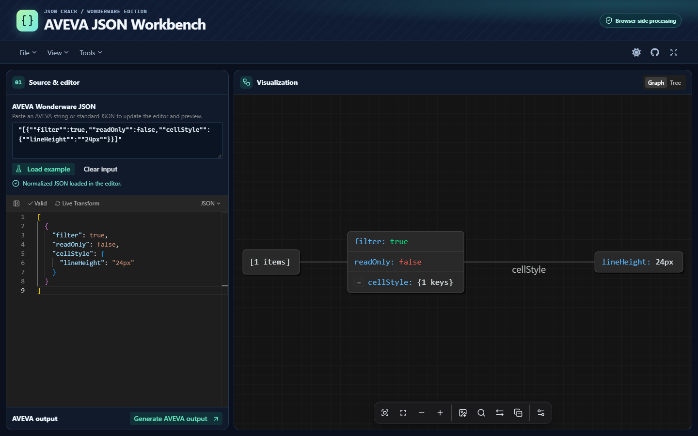
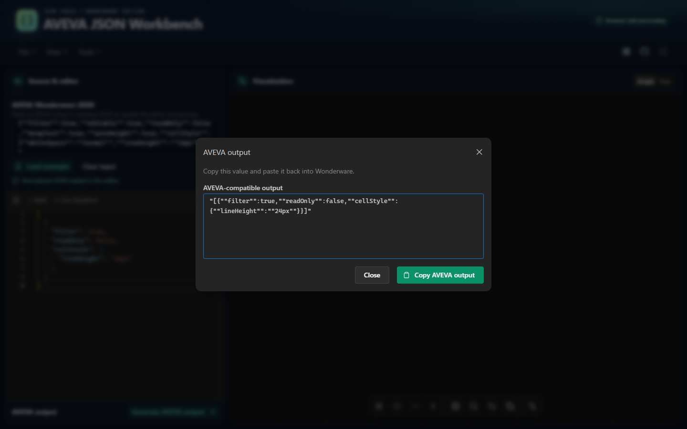

# AVEVA JSON Workbench

A local, browser-based workbench for inspecting JSON copied from AVEVA Wonderware. Paste a quoted Wonderware value into **AVEVA Wonderware JSON** and the formatted document appears in the editor and interactive preview.

The interface starts in dark mode and remembers a theme change. On desktop, drag the divider to resize the editor and visualization. On a narrow screen, use **Source & editor** and **Visualization** to switch panels.



[Open the interactive installation and user guide](https://michele-tn.github.io/AVEVA-JSON-Workbench/)

## Quick start

Use Node.js 24 or later and pnpm 10.20.0. From the project directory, run:

```sh
pnpm install --frozen-lockfile
pnpm dev:www
```

Open [http://localhost:3000](http://localhost:3000). Keep the terminal open while you use the workbench. The first page load may take longer because Next.js compiles the development bundle.

If port 3000 is already in use, run:

```sh
pnpm exec turbo run dev --filter=www -- --port 3001
```

Open [http://localhost:3001](http://localhost:3001).

## Load a document

1. Paste the value copied from Wonderware into **AVEVA Wonderware JSON**, or select **Load example**.
2. Inspect or edit the normalized JSON in the editor. The preview updates automatically. On a narrow screen, select **Visualization** to see it.
3. Select **Graph** or **Tree**. Use **File → Export** to download the current document, or use the export control in the graph toolbar to save an image.
4. To paste the edited document back into Wonderware, select **Generate AVEVA output** below the editor. The output dialog opens with the read-only value focused and a **Copy AVEVA output** button. Close the dialog with **Escape** or **Close**. Generation uses the current valid JSON object or array.

For example, the input below:

```text
"[{""filter"":true,""readOnly"":true,""cellStyle"":{""lineHeight"":""16px""}}]"
```

becomes:

```json
[
  {
    "filter": true,
    "readOnly": true,
    "cellStyle": {
      "lineHeight": "16px"
    }
  }
]
```

The source field also accepts standard JSON and JSON strings containing a serialized object or array. Invalid or incomplete input stays in the field for correction while the editor and preview keep the last valid document. **Clear input** resets the source field so you can paste a new value.

<details>
<summary>Preview the AVEVA output dialog</summary>



</details>

## Included tools

- Interactive graph and tree, node inspection, search, zoom, layout rotation, collapse and expand.
- File and URL import, drag and drop, and conversion between JSON, YAML, CSV, and XML.
- JSON Schema, JSONPath, jq, and type generation.
- Data export and PNG, JPEG, or SVG graph export.

The graph retains the upstream node limit for rendering. Switch to Tree view when a document exceeds it. The local edition includes the open-source editor and has no paid upgrade flow. The pasted document is processed in the browser. The editor bundle is served with the application.

## Verify and build

```sh
pnpm lint
pnpm test
pnpm build:www
```

The web build produces a static site in `apps/www/out`. See [CONTRIBUTING.md](./CONTRIBUTING.md) for verification steps and the source layout.

## Windows single executable

On Windows, use the official Node.js 24.8 or later binary for the target architecture and install Windows SDK Signing Tools. Set `SIGNTOOL_PATH` if SignTool is outside the standard SDK folder. Install the project dependencies, then build the executable:

```powershell
pnpm install --frozen-lockfile
pnpm release:sea
```

The release command requires 7-Zip. On x64 it writes the signed `dist/sea/AVEVA-JSON-Workbench-win-x64.exe`, a public `.cer` certificate, and a `.7z` archive using LZMA2 Ultra compression. The archive includes the HTML guide. The executable icon has 23 frames from 16 to 256 pixels. Use `pnpm build:sea` when you only need the unsigned executable.

Launch the executable to open the workbench at [http://127.0.0.1:8787](http://127.0.0.1:8787). It contains the web assets and the Node.js runtime. The target computer only needs a browser.

Use `--port 8788` to select a different port or `--no-open` to start the local server without opening a browser. Press **Ctrl+C** in the console to stop it.

### Access from the local network

Stop any Workbench instance already using port 8787. From the extracted release folder, run the executable with LAN access enabled.

```powershell
.\AVEVA-JSON-Workbench-win-x64.exe --lan
```

The executable keeps the local URL available and prints a second URL for devices on the same subnet. If more than one interface is available, pass `--lan-address` followed by the LAN IPv4 address. Allow the executable through Windows Firewall on your trusted network profile if prompted.

To allow a second routed subnet, add `--allow-subnet` with its IPv4 CIDR. For example, if the host is `192.168.1.50/24`, this command serves both `192.168.1.0/24` and `192.168.2.0/24`.

```powershell
.\AVEVA-JSON-Workbench-win-x64.exe --lan-address 192.168.1.50 --allow-subnet 192.168.2.0/24
```

Repeat the option for each additional subnet. Clients still open the URL printed for the host's LAN interface. Routing and the Windows firewall must allow TCP traffic to that address and port. See the [two-subnet setup and checks](https://michele-tn.github.io/AVEVA-JSON-Workbench/#routed-lan) for a scoped firewall rule and client tests.

For automatic firewall setup through Caddy, run the [LAN launcher](./scripts/Start-WorkbenchLan.ps1) from PowerShell 7 in the extracted release or repository folder.

```powershell
pwsh -NoProfile -File .\scripts\Start-WorkbenchLan.ps1
```

The launcher downloads the latest official Caddy release, verifies its SHA-256, and starts both processes. Open the printed LAN URL from a device on the same subnet. Approve the Windows firewall prompt if it appears. The rule applies to Private and Domain profiles and stays available for later launches. Press **Ctrl+C** to stop both processes.

Use `-LanAddress` to select the host IPv4 address, `-Port 8788` to use another port, or `-WorkbenchPath` to point to an extracted executable. On a managed network, use `-SkipFirewall` once the administrator has allowed the port. LAN access uses HTTP without authentication. Use it on a trusted network.

The release script creates or reuses a self-signed Authenticode certificate in the current user's Personal store. The archive includes the public certificate. Windows does not trust a self-signed publisher by default. Verify the fingerprint out of band before trusting a certificate.

Open the generated guide in `dist/sea` to download the local archive and checksum. The hosted guide downloads both files from the `Release-assets` folder in this repository.

The build retrieves the license for the Node.js version used to create the executable when the installation does not contain it. For an offline build with dependencies already installed, set `NODE_SEA_LICENSE` to the matching Node.js `LICENSE` file. Embedded license texts are available at `/licenses/node.txt`, `/licenses/workbench.txt`, and `/licenses/web.txt`.

## Attribution

Based on [JSON Crack](https://github.com/AykutSarac/jsoncrack.com) by Aykut Saraç and contributors, at commit [`a46d0d0`](https://github.com/AykutSarac/jsoncrack.com/commit/a46d0d0adb098e12e577a083e87ead7f61f90098). This independent adaptation adds Wonderware input normalization and a responsive workbench. See the original [license](./LICENSE) and the [web app license](./apps/www/LICENSE.md).
